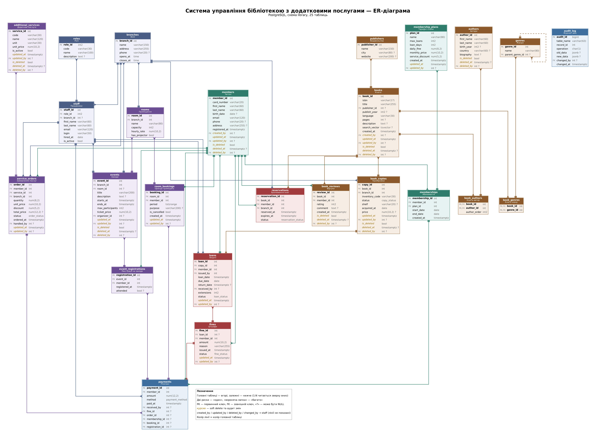

# Звіт з лабораторної роботи №1

**Тема:** проєктування та реалізація реляційної бази даних з використанням збережених процедур, тригерів, представлень та патернів Repository + Unit of Work

**Варіант:** система управління бібліотекою з додатковими послугами

**Виконала:** Анна Кучерова

---

## Мета роботи

Спроєктувати та реалізувати реляційну базу даних для системи управління бібліотекою в СУБД PostgreSQL. Створити серверну логіку (збережені процедури, функції, тригери, представлення, індекси) і реалізувати роботу з базою з коду на C# за допомогою патернів Repository та Unit of Work.

## Завдання

1. Розробити схему бази даних із зазначенням зв'язків між об'єктами, полів, ключів тощо.
2. Мінімальна кількість сутностей — 15.
3. Сутності мають спиратися на сформовані вимоги. Деякі сутності мають підтримувати soft delete, деякі — зберігати дату останньої зміни даних і користувача, що їх змінив.
4. Реалізувати модель в одній з реляційних СУБД (MS SQL, MySQL/MariaDB, PostgreSQL).
5. Створити й використати збережені процедури, користувацькі функції, тригери, представлення (View) тощо, насамперед для роботи із сутностями з п. 3 (мінімум 10).
6. Створити індекси (хоча б 2 різні типи).
7. Реалізувати роботу з кількома сутностями БД з коду: комбінацію патернів Repository + Unit of Work для кількох логічно пов'язаних сутностей, де всі запити йдуть через збережені процедури та представлення.

## Використані технології

PostgreSQL 18, C# (.NET 9), Npgsql, dbdiagram.io (DBML), pgAdmin 4.

---

## Хід роботи

### 1. Аналіз предметної області та вимоги

Бібліотека має кілька філій. Вона видає книги читачам, бере штрафи за прострочення і надає додаткові платні послуги. На основі цього сформовано вимоги до системи.

**Функціональні вимоги:**

1. Облік філій, працівників та їхніх ролей (адміністратор, бібліотекар, менеджер послуг, каталогізатор).
2. Реєстрація читачів з видачею читацького квитка, редагування, видалення (soft delete) і відновлення.
3. Тарифні плани абонементів (ліміт книг, термін видачі, розмір пені за день, знижка на послуги) і придбання абонементів з оплатою. Періоди абонементів одного читача не можуть перетинатися.
4. Каталог книг: автори, видавництва, ієрархія жанрів, зв'язки «багато-до-багатьох» книга-автор і книга-жанр, повнотекстовий і нечіткий пошук.
5. Облік фізичних примірників у філіях зі статусами: доступний, виданий, зарезервований, у ремонті, втрачений, списаний.
6. Видача книг з перевірками: чинний абонемент, ліміт книг, відсутність боргів і прострочень, доступність примірника.
7. Повернення книг з автоматичним штрафом за прострочення. Продовження терміну не більше 2 разів і лише тоді, коли книгу не очікують інші читачі.
8. Бронювання книг із чергою: після повернення примірник автоматично резервується для першого читача в черзі.
9. Додаткові послуги: друк, сканування, ксерокопіювання, міжбібліотечний абонемент, ламінування, робоче місце з ПК; знижка залежно від тарифу.
10. Оренда приміщень з контролем накладок у часі та робочих годин філії.
11. Заходи (зустрічі з авторами, майстер-класи) з обмеженою кількістю місць і платними квитками.
12. Облік усіх платежів: штрафів, послуг, абонементів, оренди, квитків.
13. Відгуки читачів про книги з рейтингом.
14. Аналітика: прострочені позики, боржники, популярні книги, статистика філій, дохід від послуг, щомісячний звіт.

**Нефункціональні вимоги:**

- soft delete для читачів, книг, примірників, авторів, послуг, заходів і відгуків;
- збереження дати останньої зміни (`updated_at`) та працівника, що змінив запис (`updated_by`), для ключових сутностей;
- журнал усіх змін (`audit_log`);
- цілісність даних на рівні БД: PK, FK, UNIQUE, CHECK, EXCLUDE;
- усі операції застосунку виконуються лише через збережені процедури (запис) і представлення (читання) у межах транзакції.

### 2. Схема бази даних

Схема `library` містить **25 таблиць**, 6 перелічуваних типів (ENUM) і 62 зовнішні ключі. Діаграму побудовано в нотації «воронячої лапки». Головні таблиці розташовано вгорі, залежні — нижче. Вихідний файл [`diagram/library.dbml`](diagram/library.dbml) можна відкрити на [dbdiagram.io](https://dbdiagram.io) (Import → DBML).



*Рисунок 1 — ER-діаграма бази даних*

На діаграмі позначено: PK — первинний ключ, FK — зовнішній ключ, «?» — поле може бути NULL. Поля soft delete та аудиту виділено курсивом. Лінії від полів `created_by`, `updated_by`, `deleted_by` до таблиці `staff` не показано, щоб не перевантажувати схему.

**Основні зв'язки:**

- `staff` → `roles`, `branches` (N:1);
- `members` 1:N `memberships` N:1 `membership_plans`;
- `books` M:N `authors` (через `book_authors`), `books` M:N `genres` (через `book_genres`), `books` N:1 `publishers`, `genres` → `genres` (батьківський жанр, самопосилання);
- `books` 1:N `book_copies` N:1 `branches`;
- `loans` пов'язує `members` і `book_copies`; `fines` → `loans`, `members`;
- `service_orders` → `members`, `additional_services`, `branches`; `room_bookings` → `rooms`, `members`; `event_registrations` → `events`, `members`;
- `payments` посилається рівно на одну ціль оплати: штраф, замовлення, абонемент, оренду або реєстрацію на захід (CHECK `num_nonnulls(...) = 1`).

### 3. Сутності, soft delete та аудит змін

| № | Таблиця | Призначення | Soft delete | Аудит змін |
|---|---|---|:---:|:---:|
| 1 | `roles` | Ролі працівників | | |
| 2 | `staff` | Працівники (користувачі системи) | | |
| 3 | `branches` | Філії бібліотеки | | |
| 4 | `members` | Читачі | + | + |
| 5 | `membership_plans` | Тарифні плани | | + |
| 6 | `memberships` | Придбані абонементи | | |
| 7 | `authors` | Автори | + | |
| 8 | `publishers` | Видавництва | | |
| 9 | `genres` | Жанри (ієрархія) | | |
| 10 | `books` | Книги каталогу | + | + |
| 11 | `book_authors` | Зв'язок книга-автор (M:N) | | |
| 12 | `book_genres` | Зв'язок книга-жанр (M:N) | | |
| 13 | `book_copies` | Примірники книг | + | + |
| 14 | `book_reviews` | Відгуки | + | |
| 15 | `loans` | Видачі книг | | + |
| 16 | `reservations` | Бронювання книг | | |
| 17 | `fines` | Штрафи | | + |
| 18 | `additional_services` | Додаткові послуги | + | + |
| 19 | `service_orders` | Замовлення послуг | | + |
| 20 | `rooms` | Приміщення | | |
| 21 | `room_bookings` | Бронювання приміщень | | + |
| 22 | `events` | Заходи | + | + |
| 23 | `event_registrations` | Реєстрації на заходи | | |
| 24 | `payments` | Платежі | | |
| 25 | `audit_log` | Журнал змін | | |

**Soft delete** реалізовано полями `is_deleted`, `deleted_at`, `deleted_by`. Звичайний `DELETE` перехоплює тригер `tf_soft_delete` і замінює його оновленням рядка. Тому навіть випадковий `DELETE` з pgAdmin не знищує дані. Одна тригерна функція обслуговує всі 7 таблиць, бо назва ключового поля передається як аргумент тригера:

```sql
CREATE OR REPLACE FUNCTION tf_soft_delete()
RETURNS TRIGGER
LANGUAGE plpgsql
AS $$
DECLARE
    v_pk_column TEXT := TG_ARGV[0];
    v_pk_value  INT  := (to_jsonb(OLD) ->> TG_ARGV[0])::INT;
BEGIN
    IF current_setting('app.allow_hard_delete', true) = 'on' THEN
        RETURN OLD;
    END IF;

    EXECUTE format(
        'UPDATE %I.%I SET is_deleted = TRUE, deleted_at = now(), deleted_by = $1 WHERE %I = $2 AND NOT is_deleted',
        TG_TABLE_SCHEMA, TG_TABLE_NAME, v_pk_column)
    USING fn_current_staff_id(), v_pk_value;

    RETURN NULL;
END;
$$;

CREATE TRIGGER trg_members_soft_delete BEFORE DELETE ON members
    FOR EACH ROW EXECUTE FUNCTION tf_soft_delete('member_id');
```

**Дата зміни і користувач.** Поля `updated_at` і `updated_by` заповнює тригер `tf_set_modified`. Працівника він бере з налаштування сесії `app.current_staff_id`, яке на початку кожної транзакції встановлює процедура `sp_set_session_staff`. Окрім цього, тригер `tf_audit_log` записує кожну зміну ключових таблиць у `audit_log` (старі й нові дані у форматі JSONB), а представлення `v_audit_trail` показує лише поля, що реально змінилися.

### 4. Реалізація в PostgreSQL

Скрипти лежать у папці [`database`](database) і виконуються по черзі файлом `00_install.sql`:

| Файл | Вміст |
|---|---|
| `01_schema.sql` | схема, ENUM-типи, 25 таблиць, обмеження |
| `02_indexes.sql` | індекси |
| `03_functions.sql` | користувацькі функції |
| `04_triggers.sql` | тригерні функції і тригери |
| `05_views.sql` | представлення і матеріалізоване представлення |
| `06_procedures.sql` | збережені процедури |
| `07_seed.sql` | тестові дані (3 філії, 6 працівників, 12 читачів, 15 книг, 55 примірників, позики, штрафи, послуги, заходи) |

Обмеження цілісності:

- `ex_memberships_overlap` — EXCLUDE USING gist: абонементи одного читача не перетинаються в часі;
- `ex_room_bookings_overlap` — EXCLUDE USING gist: одне приміщення не можна забронювати двічі на той самий час;
- CHECK: коректність email, періодів, рейтингу 1–5, кількості продовжень 0–2, узгодженість полів soft delete;
- згенеровані колонки: `books.search_vector` (для повнотекстового пошуку), `service_orders.total_price`.

### 5. Серверна логіка

Загалом створено **24 процедури, 11 функцій, 30 тригерів і 16 представлень**.

**Користувацькі функції (11):**

| Функція | Призначення |
|---|---|
| `fn_current_staff_id()` | Працівник поточної сесії |
| `fn_require_staff()` | Те саме, але з помилкою, якщо працівник не визначений |
| `fn_member_plan_id(member, date)` | Чинний тарифний план читача на дату |
| `fn_active_loans_count(member)` | Кількість книг на руках |
| `fn_member_debt(member)` | Сума неоплачених штрафів |
| `fn_available_copies(book, branch)` | Кількість доступних примірників |
| `fn_calc_fine(loan, date)` | Розрахунок штрафу: дні прострочення × ставка тарифу, але не більше подвійної вартості книги |
| `fn_member_can_borrow(member)` | Чи може читач отримати книгу |
| `fn_generate_card_number(id)` | Номер читацького квитка |
| `fn_search_books(query, limit)` | Пошук книг (повнотекстовий + триграмний), повертає таблицю |
| `fn_member_service_discount(member)` | Знижка на послуги за тарифом |

**Збережені процедури (24):**

| Група | Процедури |
|---|---|
| Сесія | `sp_set_session_staff` |
| Читачі | `sp_member_register`, `sp_member_update`, `sp_member_soft_delete`, `sp_member_restore`, `sp_membership_purchase` |
| Каталог | `sp_book_create`, `sp_book_update`, `sp_book_soft_delete`, `sp_copy_add`, `sp_copy_write_off` |
| Обіг книг | `sp_loan_issue`, `sp_loan_return`, `sp_loan_extend`, `sp_mark_overdue_loans`, `sp_reservation_create`, `sp_reservation_cancel` |
| Фінанси | `sp_fine_pay`, `sp_fine_waive` |
| Послуги | `sp_service_order_create`, `sp_service_order_complete`, `sp_room_booking_create`, `sp_event_register` |
| Звіти | `sp_refresh_reports` |

Процедури повертають результат через параметри `INOUT` (id створеного запису, дату повернення, суму штрафу). Помилки генеруються з кодами SQLSTATE: `P0001` — порушення бізнес-правила, `P0002` — запис не знайдено.

**Тригери (30 тригерів, 8 тригерних функцій):**

| Тригерна функція | Таблиці | Дія |
|---|---|---|
| `tf_set_modified` | 10 таблиць | Заповнює `updated_at`, `updated_by` |
| `tf_set_created_by` | `members`, `books` | Заповнює `created_by` |
| `tf_soft_delete` | 7 таблиць | Замінює `DELETE` на soft delete |
| `tf_audit_log` | 7 таблиць | Записує зміни в `audit_log` |
| `tf_loans_before_insert` | `loans` | Перевіряє доступність примірника, бронювання, статус читача |
| `tf_loans_sync_copy_status` | `loans` | Змінює статус примірника при видачі й поверненні, обробляє чергу бронювань |
| `tf_event_registration_check` | `event_registrations` | Контролює кількість місць і дату заходу |
| `tf_reservation_check` | `reservations` | Забороняє бронювання видаленими читачами або видалених книг |

**Представлення (15 + 1 матеріалізоване):** `v_members`, `v_members_archive`, `v_books_catalog`, `v_book_copies`, `v_loans`, `v_active_loans`, `v_overdue_loans`, `v_fines`, `v_member_debts`, `v_popular_books` (з віконною функцією `dense_rank`), `v_branch_statistics`, `v_service_revenue`, `v_upcoming_events`, `v_room_schedule`, `v_audit_trail`, `mv_monthly_report`. Представлення каталогу та читачів автоматично приховують записи, позначені як видалені.

### 6. Індекси

Створено 28 індексів (разом з індексами первинних ключів і обмежень — 69) різних типів:

| Тип | Приклади | Призначення |
|---|---|---|
| B-tree (звичайний, складений) | `ix_members_name`, `ix_copies_book_branch_status` | Пошук і сортування |
| Частковий (`WHERE`) | `ix_loans_member_active WHERE return_date IS NULL` | Індексуються лише активні позики |
| Унікальний частковий / за виразом | `ux_books_isbn_active`, `ux_members_email_active ON lower(email)`, `ux_loans_copy_open` | Унікальність лише серед не видалених записів; одна відкрита позика на примірник |
| Покривний (`INCLUDE`) | `ix_loans_due_date` | Index-only scan для пошуку прострочень |
| Hash | `ix_members_phone_hash` | Пошук за точним номером телефону |
| GIN | `ix_books_search` (tsvector), `ix_books_title_trgm` (pg_trgm), `ix_audit_log_new_data` (JSONB) | Повнотекстовий і нечіткий пошук, пошук у JSONB |
| GiST | `ix_room_bookings_period`, EXCLUDE-обмеження | Пошук по діапазонах часу |
| BRIN | `ix_loans_loan_date_brin`, `ix_payments_paid_at_brin`, `ix_audit_log_changed_at_brin` | Компактні індекси для хронологічних даних |

### 7. Робота з базою з коду: Repository + Unit of Work

Застосунок написано на C# (.NET 9) з використанням бібліотеки Npgsql.

```
src/LibraryApp/
├── Domain/         моделі: Member, Book, BookCopy, Loan, Fine, AuditEntry; LibraryException
├── Data/           IUnitOfWork, UnitOfWork, UnitOfWorkFactory, DbSession, обробка помилок БД
├── Repositories/   RepositoryBase, IReadRepository<T, TKey>,
│                   MemberRepository, BookRepository, LoanRepository, FineRepository, AuditRepository
├── Services/       LibraryService — бізнес-сценарії
└── Program.cs      демонстрація роботи
```

**Unit of Work** відкриває з'єднання і транзакцію та викликає `sp_set_session_staff`, щоб тригери знали, який працівник вносить зміни. Репозиторії створюються в межах одного Unit of Work і працюють у спільній транзакції. Зміни кількох сутностей або фіксуються разом (`CommitAsync`), або відкочуються. Відкат виконується й автоматично, якщо `CommitAsync` не викликали.

**Repository.** Кожен репозиторій читає дані лише з представлень (`v_members`, `v_books_catalog`, `v_book_copies`, `v_loans`, `v_active_loans`, `v_overdue_loans`, `v_fines`, `v_audit_trail`) і змінює лише через `CALL` збережених процедур:

```csharp
public async Task<LoanReceipt> IssueAsync(int memberId, int copyId, CancellationToken ct = default)
{
    var row = await CallAsync(
        "CALL sp_loan_issue(@member_id, @copy_id, NULL, NULL)",
        ct,
        P("member_id", memberId),
        P("copy_id", copyId));

    return new LoanReceipt(ToInt(row[0]), copyId, ToDate(row[1]));
}
```

Приклад операції з кількома сутностями: видача кількох книг виконується в одному Unit of Work. Якщо хоча б одна книга недоступна, не видається жодна:

```csharp
await using var uow = await _uowFactory.BeginAsync(staffId, ct);

var receipts = new List<LoanReceipt>(inventoryCodes.Count);
foreach (var code in inventoryCodes)
{
    var copy = await uow.Books.GetCopyByInventoryCodeAsync(code, ct)
               ?? throw new LibraryException(LibraryErrorKind.NotFound, $"Примірник {code} не знайдено");

    receipts.Add(await uow.Loans.IssueAsync(memberId, copy.Id, ct));
}

await uow.CommitAsync(ct);
```

Помилки бази даних перетворюються на `LibraryException` з типом помилки (порушення бізнес-правила, запис не знайдено, конфлікт, немає доступу).

### 8. Результати роботи

Демонстраційна програма виконує 11 сценаріїв. Фрагмент виводу:

```
1. Пошук книг у каталозі (fn_search_books)
------------------------------------------
  Запит: "Жадан"
    #8   Інтернат                     Сергій Жадан                   доступно: 4
    #9   Ворошиловград                Сергій Жадан                   доступно: 5
  Запит: "Design patern"
    #14  Design Patterns              Ерих Гамма, Річард Гелм, Ральф Джонсон, Джон Вліссідес доступно: 2

2. Реєстрація читача + купівля абонемента в одній транзакції
------------------------------------------------------------
  LIB-00000014 Оксана Демченко <oksana.demchenko224811@gmail.com>
  Тариф: Стандарт до 16.04.2027, книг на руках: 0, борг: 0,00 грн, змінив: imelnyk

3. Видача двох книг (позики + зміна статусу примірників тригером)
-----------------------------------------------------------------
  Позика #25: примірник 20, повернути до 06.11.2026
  Позика #26: примірник 46, повернути до 06.11.2026
    INV-1-005-1   Центральна бібліотека    Available
    INV-1-005-2   Центральна бібліотека    OnLoan

4. Атомарність: друга книга недоступна -> відкат усієї операції
---------------------------------------------------------------
  Помилка (BusinessRule): Примірник 20 недоступний (статус: on_loan)
  Статус INV-1-004-1 після відкату: Available

7. Повернення простроченої книги зі сплатою штрафу
--------------------------------------------------
  Позику #14 закрито. Штраф: 55,00 грн, платіж #19

9. Soft delete: читач з книгою на руках не може бути видалений
--------------------------------------------------------------
  Помилка (BusinessRule): Читач 14 має неповернені книги
  У v_members: відсутній
  Архів: LIB-00000014 Оксана Демченко, видалено 16.10.2026 22:48 (imelnyk)

10. Відновлення читача та журнал змін
-------------------------------------
  22:48:11 INSERT by imelnyk   {"email": "oksana.demchenko224811@gmail.com", "phone": "+380671234567", ...
  22:48:11 UPDATE by imelnyk   {"deleted_at": "2026-10-16T22:48:11+03:00", "deleted_by": 2, "is_deleted": true, ...
  22:48:11 UPDATE by imelnyk   {"deleted_at": null, "deleted_by": null, "is_deleted": false, ...
```

Що підтверджують результати:

- пошук працює і за точним збігом, і з помилкою в слові (триграмний індекс);
- реєстрація читача та купівля абонемента відбуваються в одній транзакції, а поле «змінив» заповнюється автоматично;
- після видачі тригер сам змінює статус примірника;
- якщо друга книга недоступна, видача першої теж скасовується (атомарність Unit of Work);
- штраф за прострочення нараховується автоматично;
- читача з неповерненою книгою видалити не можна, а видалений читач зникає з `v_members`, але лишається в архіві;
- журнал змін фіксує, хто і що змінив.

---

## Запуск

```bash
createdb library_db
cd database
psql -d library_db -f 00_install.sql

cd ../src
dotnet run --project LibraryApp 'Host=localhost;Database=library_db;Username=postgres;Password=ПАРОЛЬ'
```

---

## Висновки

У роботі спроєктовано та реалізовано базу даних системи управління бібліотекою з додатковими послугами в PostgreSQL. База містить 25 сутностей і підтримує soft delete (7 таблиць) та аудит змін із фіксацією дати і працівника (10 таблиць), а також повний журнал змін.

Бізнес-правила реалізовано на рівні СУБД: 24 збережені процедури, 11 функцій, 30 тригерів і 16 представлень. Тому правила виконуються однаково незалежно від того, звідки змінюються дані. Цілісність забезпечують первинні й зовнішні ключі, CHECK- та EXCLUDE-обмеження. Для прискорення запитів створено індекси восьми типів: B-tree, частковий, унікальний за виразом, покривний, Hash, GIN, GiST, BRIN.

Застосунок на C# працює з кількома пов'язаними сутностями через патерни Repository та Unit of Work. Усі запити йдуть лише через збережені процедури та представлення, а операції, що зачіпають кілька таблиць, виконуються атомарно.
